# lab8web.
# Lab8.web

# LAPORAN PRAKTIKUM 8
## PHP dan Database MySQL

### 1. Tujuan Praktikum
Praktikum ini bertujuan untuk memahami cara menghubungkan PHP dengan database MySQL serta menerapkan operasi CRUD (Create, Read, Update, Delete) pada aplikasi pengelolaan data barang.

### 2. Persiapan Praktikum
Perangkat dan aplikasi yang digunakan:
- XAMPP sebagai web server.
- Visual Studio Code sebagai editor kode.
- Browser untuk menjalankan aplikasi.
- PHP dan MySQL sebagai bahasa pemrograman dan database.

### 3. Menjalankan XAMPP
Langkah pertama adalah membuka XAMPP Control Panel, kemudian menjalankan:
- Apache
- MySQL

Kedua layanan tersebut digunakan agar aplikasi PHP dan database dapat berjalan.

.png)

### 4. Membuat Database MySQL
Membuka phpMyAdmin melalui alamat:

`http://localhost/phpmyadmin/`

Kemudian membuat database dengan nama `latihan1`.

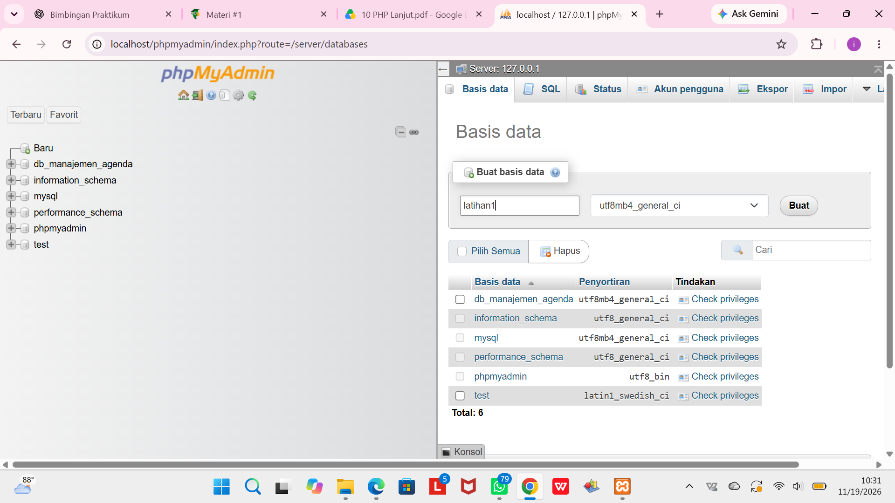

### 5. Membuat Tabel Data Barang
Di dalam database `latihan1`, dibuat tabel dengan nama `data_barang` yang memiliki 7 kolom:
1. id_barang
2. kategori
3. nama
4. gambar
5. harga_beli
6. harga_jual
7. stok
Kolom `id_barang` digunakan sebagai Primary Key dan Auto Increment.

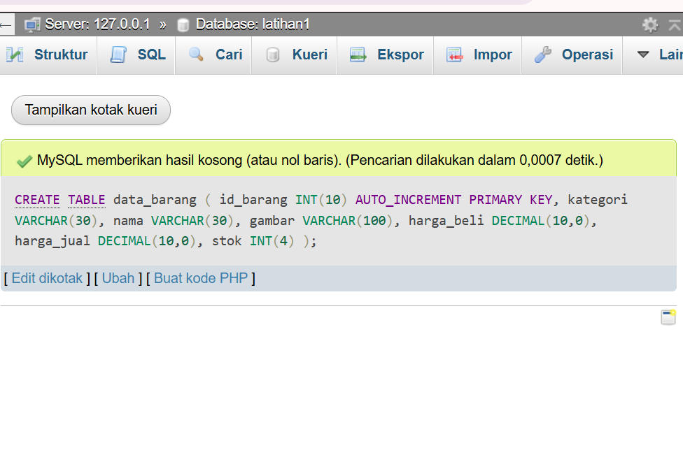
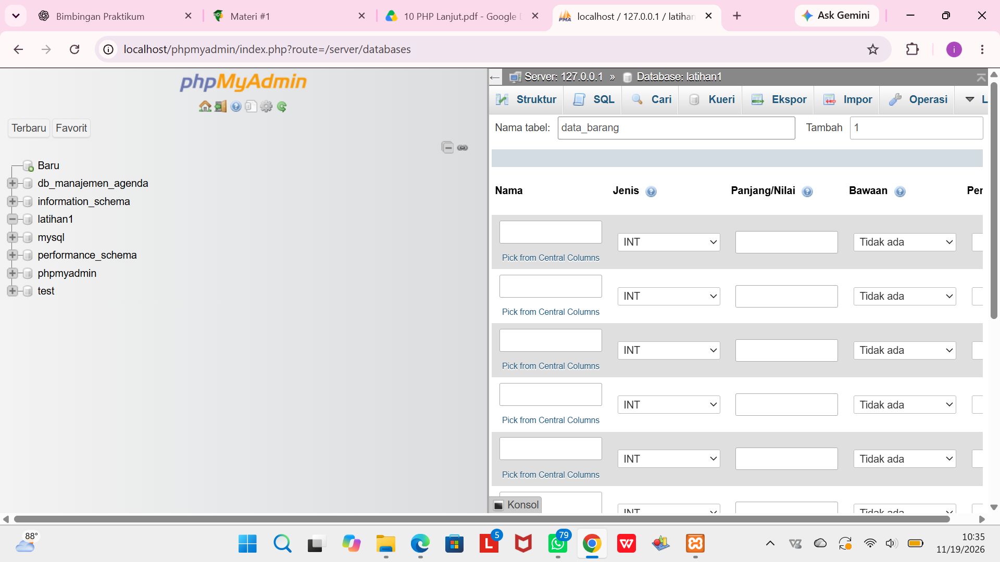

### 6. Mengisi Data Barang
Memasukkan tiga data barang ke dalam tabel `data_barang`, yaitu:
- HP Samsung Android
- HP Xiaomi Android
- HP OPPO Android

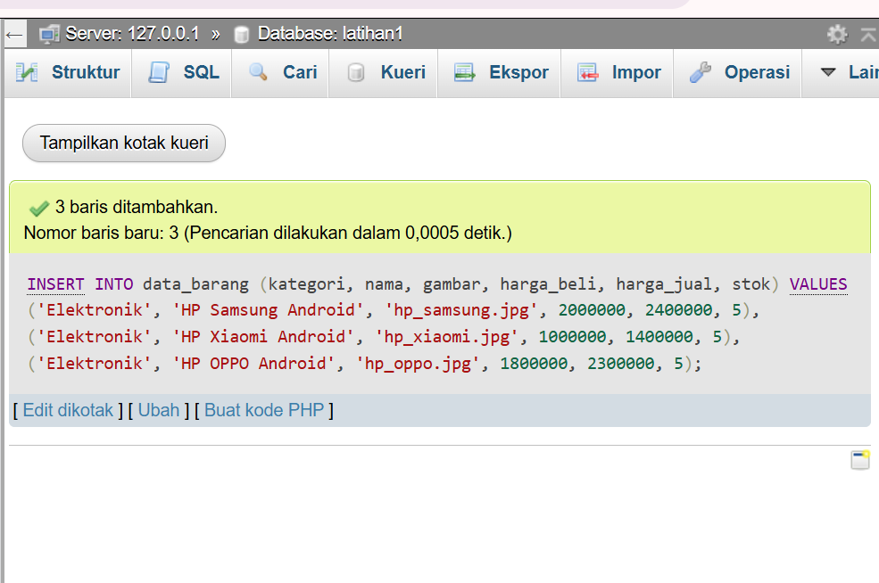

### 7. Membuat Koneksi PHP ke MySQL
Membuat file `koneksi.php` untuk menghubungkan aplikasi PHP dengan database `latihan1`.

Koneksi diuji melalui browser dan berhasil terhubung ke database.

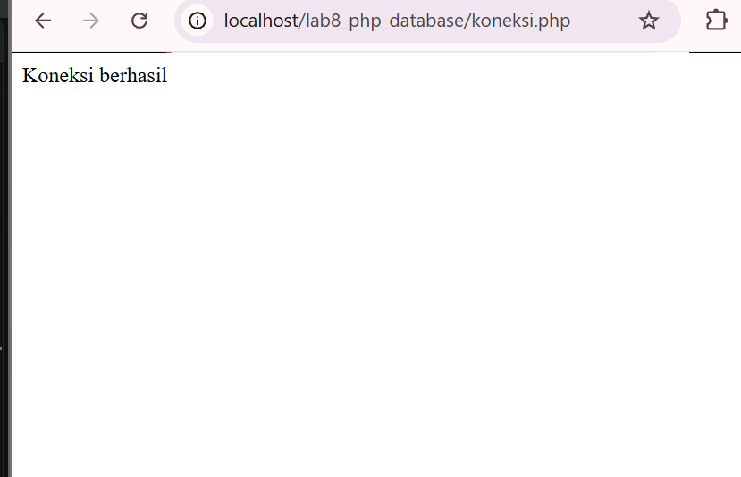

### 8. Menampilkan Data Barang (Read)
Membuat file `index.php` untuk mengambil dan menampilkan data barang dari database menggunakan perintah SQL `SELECT`.

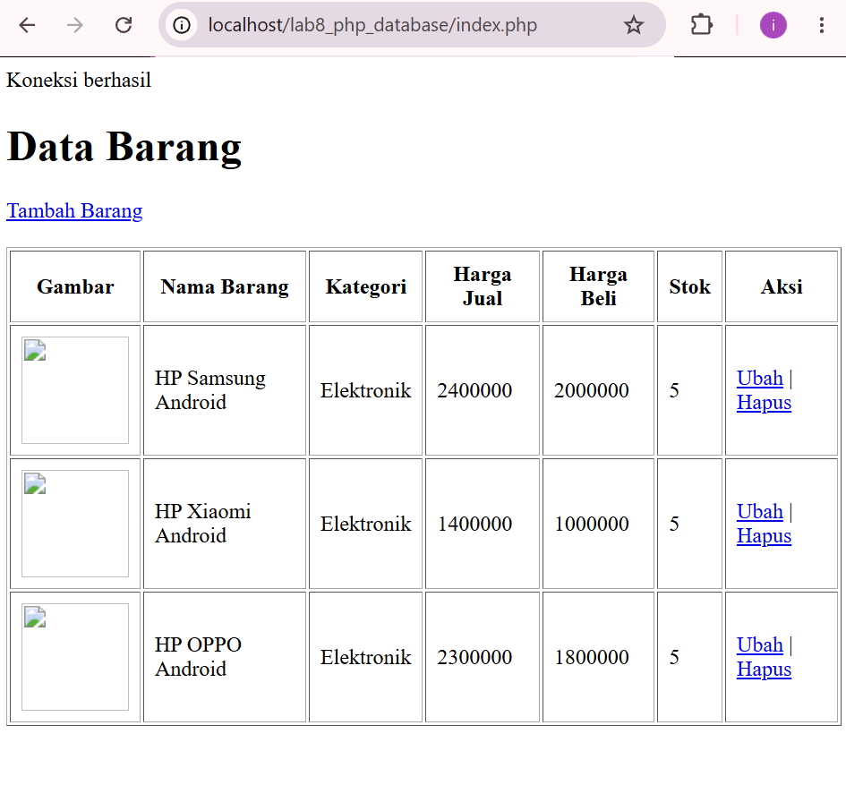

### 9. Menambahkan Data Barang (Create)
Membuat file `tambah.php` yang berisi formulir untuk memasukkan data barang baru ke database menggunakan perintah SQL `INSERT`.

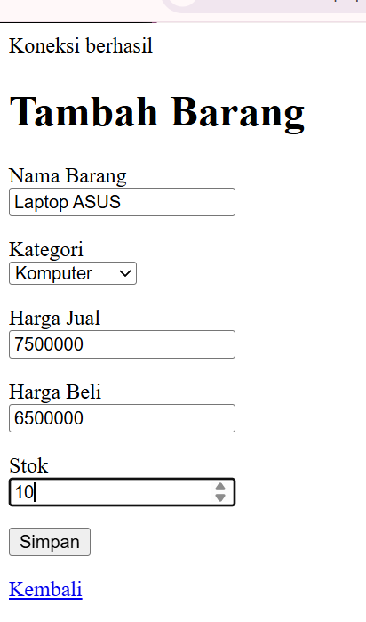

Setelah data disimpan, barang baru berhasil ditampilkan pada halaman utama.

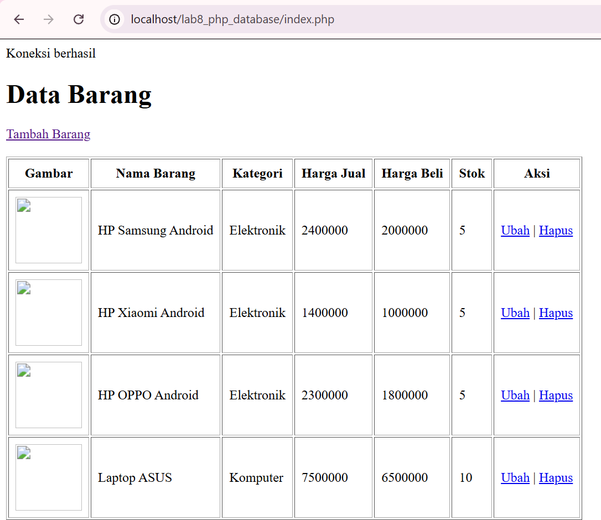

### 10. Mengubah Data Barang (Update)
Membuat file `ubah.php` untuk mengubah informasi barang yang sudah tersimpan menggunakan perintah SQL `UPDATE`.

Setelah perubahan disimpan, data barang berhasil diperbarui.

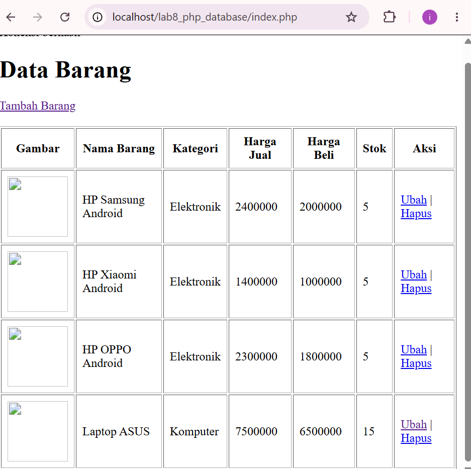

### 11. Menghapus Data Barang (Delete)
Membuat file `hapus.php` untuk menghapus data barang berdasarkan ID menggunakan perintah SQL `DELETE`.

Data barang yang dipilih berhasil dihapus dari database.

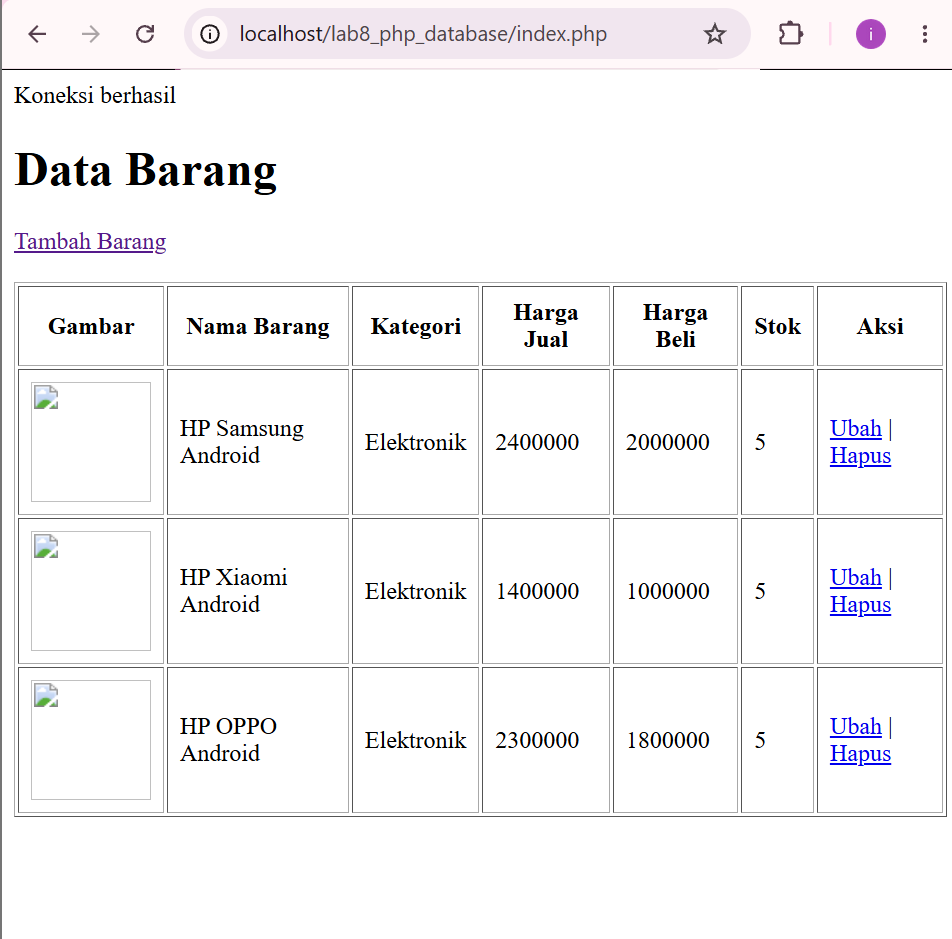

### 12. Membuat Tampilan dengan CSS
Membuat file `style.css` untuk mengatur tampilan aplikasi agar lebih rapi dan mudah digunakan.

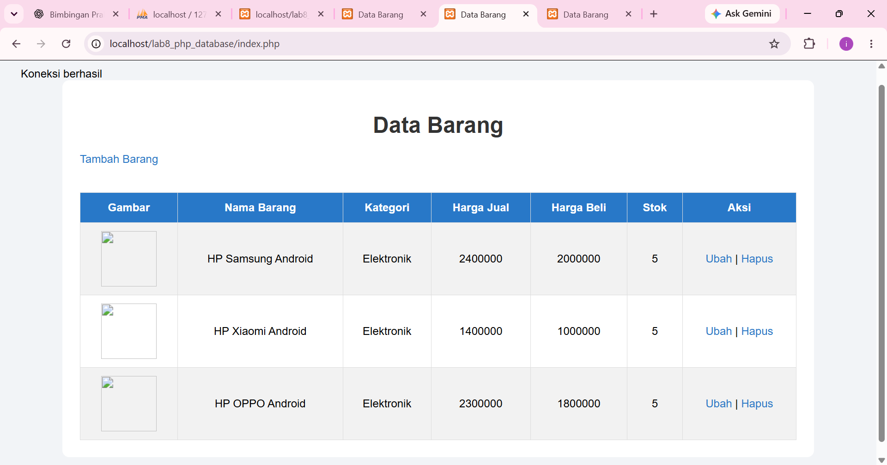

### 13. Menjalankan Aplikasi
Aplikasi dijalankan melalui browser menggunakan alamat:

`http://localhost/lab8_php_database/`

Halaman tersebut menampilkan aplikasi pengelolaan data barang yang sudah terhubung dengan database MySQL.

### 14. Kesimpulan
Berdasarkan praktikum yang telah dilakukan, saya berhasil membuat aplikasi sederhana menggunakan PHP dan MySQL. Aplikasi dapat terhubung dengan database, menampilkan data, menambahkan data, mengubah data, dan menghapus data. Praktikum ini membantu memahami dasar pengelolaan database serta penerapan CRUD dalam pemrograman web.

**Catatan:** Fitur unggah foto barang pada formulir tambah dan ubah belum diterapkan dalam praktikum ini.
